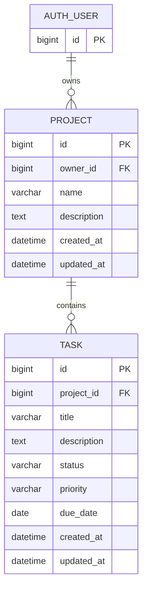

# Database Design

## The Tables We Have

The Django authentication migrations provide the built-in user table, `auth_user`. Our app migrations add:

| Table | Purpose | Important columns |
| --- | --- | --- |
| `auth_user` | Django accounts and authentication data | `id` primary key, username and password-related fields |
| `projects_project` | Projects and their owner | `id`, `owner_id`, `name`, `description`, `created_at`, `updated_at` |
| `tasks_task` | Tasks and their parent project | `id`, `project_id`, `title`, `description`, `status`, `priority`, `due_date`, timestamps |

The table names follow Django's default rule: app label plus model name. The Python import package is `apps.projects`, but the Django app label is `projects`, so the table is named `projects_project`.

## Entity Relationship Diagram

## Primary Keys

A primary key uniquely identifies a row. Django added an `id` primary key to each model even though we did not declare one in Python. In this project Django uses a `BigAutoField`: the database assigns a new numeric ID when a row is inserted.

## Foreign Keys and One-to-Many Relationships

`Project.owner` is a `ForeignKey` to Django's configured user model. In the database, each project row stores the owner's ID in `owner_id`. One user can own many projects, while each project has exactly one owner.

`Task.project` is a `ForeignKey` to `Project`. Each task stores one `project_id`; a project can contain many tasks. `Task.project` follows a task to its project. The `related_name` options create convenient reverse access: `user.projects.all()` finds that user's projects, and `project.tasks.all()` finds a project's tasks.

Both foreign keys use `on_delete=models.CASCADE`. Deleting a user therefore deletes that user's projects, and deleting a project deletes its tasks. This is a deliberate ownership/data-lifecycle choice. The database and Django keep the referenced IDs consistent.

## Many-to-Many Relationships

There is no many-to-many relationship in this first design. A task belongs to one project, and a project has one owner. A many-to-many table would only be needed if requirements changed, for example to let several users collaborate on the same project. It is better not to add a relationship the current application does not need.

## Constraints and Indexes

The database requires project names and task titles, and each task must reference an existing project. Django creates indexes for `ForeignKey` fields by default, which helps lookups through `owner_id` and `project_id`. We have not added custom indexes or uniqueness constraints: the current requirements do not say project names must be unique, and we will choose any extra indexes based on real filters and query patterns.

## From Models to Tables

The classes in `apps/projects/models.py` and `apps/tasks/models.py` are the Python description of the schema. `makemigrations` records model changes as migration instructions; `migrate` executes those instructions against SQLite. The user table existed already because the built-in authentication migrations were applied during project setup.